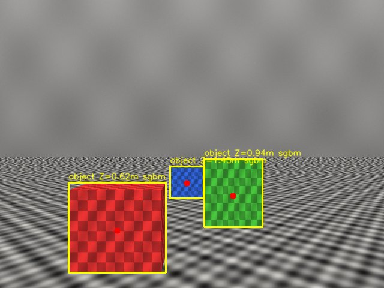
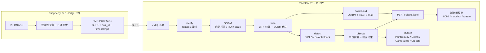
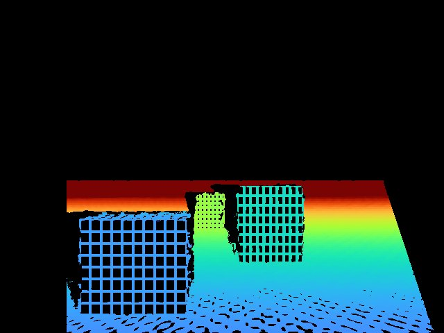
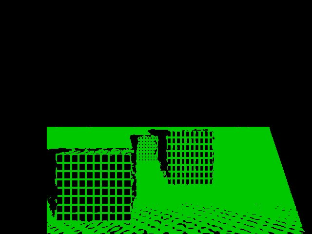

# Stereo Perception — Host

> 双 IMX219 实时双目 3D 感知：校正、SGBM、物体级 3D、体素点云与 ROS 2 输出。


-22314E?logo=ros&logoColor=white)



这是**双仓库双目感知系统**的主机端（Host）。Pi 端负责采集、时间戳同步和推流；本仓库负责：

```text
接收双帧 → 去畸变/极线校正 → SGBM → 左右一致性 + 纹理门控
        → SGBM 优先融合 → 检测 → 物体 3D → 深度图/体素点云
        → PLY / objects.jsonl / ROS 2 PointCloud2 / Foxglove
```

- **Edge / Pi 端**：[`pi5-stereo-perception-edge`](https://github.com/zmmmawzfl/pi5-stereo-perception-edge)
- 两端通过 ZMQ + `SDP1` 协议通信；本仓库不包含 `pi/` 采集代码。

---

## 1. 项目定位

面向机器人视觉感知，而不是 3D 建模：

| 用途 | 输出 |
|---|---|
| 导航避障 | 校正深度图、体素彩色点云、ROS 2 `PointCloud2` |
| 抓取初筛 | 2D 框 + 框内点云 + 物体 3D 中心 + `depth_source` |
| 场景理解 | 物体级 JSON、地面约束后的 3D 位置、覆盖率 |
| 硬件/算法评估 | 标定 RMS、极线误差、同步、压缩伪影、帧率报告 |

**非目标**：完整 3D 建模、可编辑 CAD、高保真纹理网格、Blender/SolidWorks 导出、SLAM、6-DoF 抓取位姿、单目深度先验。

SGBM 是**度量锚点**；学习型匹配器只是阶段三的可回退补全，必须同时通过“误差下降 / 覆盖率扩大 / 帧率达标”三项才保留，否则退回纯 SGBM。

## 2. 处理链路



## 3. 功能

- **双目标定**：单目 → `stereoCalibrate` → `stereoRectify`；`B=‖T‖`、`f=P1(0,0)` 从标定读，不写死 83 mm；
- **SGBM 主线**：`numDisparities` 默认 96；设 `sgbm.min_depth_m` 后按 `f·B/Z` 自动放大（640 档 0.5 m → 80），支持 ROI 裁剪与 `scale` 降分辨率；
- **融合路由**：左右一致性 `|dL-dR|<=1`；第二道局部纹理门限 `sgbm.fuse_texture_gate` 默认**关**（SGBM 已按 `texture_threshold` 过滤，再门一次会把覆盖从 32% 砍到 16%）；SGBM 有效像素优先，学习型只补失效区，**不做加权平均**；
- **物体级 3D**：框内有效视差中位数 → 深度；地面 RANSAC 约束修正质心高度，同时保留无约束结果；
- **点云**：`Z=fB/d` 反投影，体素 0.03 m 降采样，PLY 二进制导出；
- **ROS 2**：`/stereo/points`、`/stereo/depth`、`/stereo/left/image_rect`、`/stereo/left/camera_info`、`/stereo/objects`（macOS 上经 robostack 实测）；
- **640×480 实时档**：Pi 推流前降采样（48.7 KB/帧）+ `stereo_calib_640.npz` → Mac 上 **13–15 fps**、单对 **57 ms**、覆盖 **32%**；
- **浏览器实时预览**：`--preview-port 8080` 起 MJPEG，左=校正图+框、右=深度伪彩、底部状态条；
- **验证报告**：标定/极线、已知距离误差、覆盖率、压缩伪影、分段耗时；
- **无相机路径**：合成场景 + 录制回放，完整跑通链路。

## 4. 当前状态

| 层 | 状态 | 说明 |
|---|---|---|
| 合成/回放完整管线 | ✅ | **152 个 unittest** 通过；`tools.run_demo` 可复现 |
| 真实双目链路（Mac） | ✅ | 现役唯一 PC 是 Mac M2（10.42.0.190）：640 档 **13–15 fps**、单对 **57 ms**、覆盖 **32%** |
| macOS 原生基础链路 | ✅ | 同上；1640 全分辨率约 2.2 fps（每对 318–344 ms） |
| Linux/NVIDIA 目标机 | ❌ 未测 | 不能在 Pi 5 上代替目标 PC 帧率 |
| 真实双目标定 | ✅ | v4 支架 + `--rotate 90`：1640 **RMS 0.634 px / B 80.196 mm**；640 **0.241 px / 80.195 mm** |
| YOLO 检测 | ⚠️ | 权重不随仓库分发；Mac 未装 ultralytics，当前 `detect.backend=color`（只验链路） |
| 学习型匹配器 | ⚠️ | 仅适配器/ONNX 预下载，未实测；Mac 没有 onnxruntime |
| ROS 2 节点 | ✅ | Mac 上 robostack humble 实测：约 **2500 点/帧**、5 物体、5 Hz；Foxglove 8765 可连；**无 rviz2** |
| 浏览器预览 | ✅ | `--preview-port 8080`，实测 **15 fps / 31.7% / 48 ms** |
| Docker ROS 2 | ⛔ 历史（x86 已移除） | 2026-11-15 的 amd64 镜像（2.13 GB、189 包、3.66 fps）只是历史基线，tar 已删；Mac 上要跑容器得重建 arm64 |

> 152 个测试里有平台/provider、ROS 打包、SGBM ROI、点云体素、预览服务等单测；**测试通过不等于实机精度通过**。

## 5. 已验证数字

上表是**合成/回放**基线（用于正确性回归）；真实相机实测在它下面（验收依据）：

| 指标 | 结果 | 条件 |
|---|---|---|
| 双目 RMS | **0.0471 px** | 15 视图合成标定 |
| 校正后极线 \|dy\| | **0.0102 px** | 中位数 |
| 基线 / 焦距 | **83.025 mm / 531.125 px** | 从标定 `T`、`P1` 读取 |
| 物体 \|ΔZ\| | **1.2 mm**（中位，0.10%） | 合成 8 帧 |
| 真值几何区覆盖率 | **65.4%** | 合成场景 |
| 点云体素化 | **20,620 → 3,518 点** | 0.03 m 体素 |
| H.264 2.5 Mbps 最大深度偏移 | **0.41%** | 压缩往返量化 |
| 处理耗时（Pi 5） | SGBM **150 ms** / 总 **266 ms** / **3.75 fps** | 2026-10-31 的 640×480 测量，仅供正确性参考（现役实时档在 Mac 上 13–15 fps） |
| Mac 短序列 demo | **20.27 fps** | M2，3 帧，非目标 PC |
| 处理耗时（x86 Pentium G4560，2026-11-15 历史） | SGBM **173.7 ms** / 总 **359.8 ms** / **2.78 fps** | 8 帧合成 demo，纯 CPU；该机器 2026-11-28 已移除 |

真实相机（2026-11-27/28，v4 支架 80 mm，Mac M2 处理）：

| 指标 | 结果 | 条件 |
|---|---|---|
| 标定（1640，20 对） | RMS **0.634 px**、B **80.196 mm**、f 1230.9 px、极线 **0.50 px** | `--rotate 90` |
| 标定（同批缩 640） | RMS **0.241 px**、B **80.195 mm**、f 482.8 px、极线 **0.194 px** | `stereo_calib_640.npz` |
| 640 实时档（端到端） | **13–15 fps**、单对 **57 ms**、覆盖 **32%**、≈2900 点、4 物体 | Pi 1640 采集 → 推流缩 640 |
| 已知距离（打印机 0.745 m） | 0.752–0.762 m（**+1%**） | 近簇中位 |
| 浏览器预览 | **15.05 fps / 31.7% / 48 ms / 7 物体** | `--preview-port 8080` |
| ROS 2（实时流） | ≈**2500 点/帧**、5 物体、5 Hz | robostack humble + CycloneDDS |
| 装配体检（Pi） | 极线残差 **2.52 px**、棋盘反推基线 **81.2 mm** | `pi.tools.rig_check` |
| 帧同步（Pi） | 640×480：52.8 ms → **0.56 ms**；1640：中位 **−25 ms**（不收敛） | P 环 200 帧 |

| 深度图 | 视差 / 源图 |
|---|---|
|  |  |

## 6. 快速开始

### 6.0 任意 Linux（x86_64 / arm64，无需编译）

```bash
python3 -m venv .venv && source .venv/bin/activate
make deps      # 自动选 requirements-linux-cpu.txt（无 GPU）/ requirements-pc.txt（NVIDIA）
make test      # 152 项
make demo
make check-docs  # 体检文档：md 里引用的文件/模块/make 目标是否真实存在
```

> 视觉链路是纯 Python，依赖都是预编译 wheel（OpenCV 自带 ximgproc），**不需要编译**；只有 ROS 2 才要额外安装或容器。
> 选型矩阵、镜像复用（tar 搬运 / buildx 多架构一次构建）与常见坑见 [docs/portability.md](docs/portability.md)。

**连 Python 环境都不想装？** 有 Docker 就行（x86_64 / arm64 / macOS / Windows 均可）：

```bash
make docker-cpu
docker run --rm --network host \
  -v "$PWD/data:/data:ro" -v "$PWD/runs:/out" \
  stereo-depth-cpu:latest \
  --endpoint tcp://10.42.0.1:5555 --calib /data/calib/stereo_calib.npz --out /out/live
```

镜像只含 numpy / PyYAML / pyzmq / opencv-contrib-headless，跑的是同一条 `pc.receive.live` 链路
（没有 YOLO/ROS 2，检测用 `--detect-backend color`）。Docker Desktop 上把 `--network host` 去掉，
直接把 `--endpoint` 指向 Pi 的 IP。

### 6.1 macOS（原生，CoreML 可选）

```bash
git clone https://github.com/zmmmawzfl/pi5-stereo-perception-host.git
cd pi5-stereo-perception-host

python3 -m venv .venv-macos
source .venv-macos/bin/activate
pip install -r requirements-macos.txt

# ultralytics 可能把 opencv-contrib 覆盖成 opencv-python；
# SGBM 右目/ximgproc 需要 contrib，装完依赖后再覆盖一次
pip install --force-reinstall --no-deps opencv-contrib-python

python -m pc.runtime        # 期望看到 CoreMLExecutionProvider
python -m unittest discover -s tests -t .
python -m tools.run_demo --out runs/demo --frames 8 --compression
```

### 6.2 Linux / NVIDIA

```bash
python3 -m venv .venv
source .venv/bin/activate
pip install -r requirements-pc.txt
python -m unittest discover -s tests -t .
python -m tools.run_demo --out runs/demo --frames 8
```

> 在无 GPU 的 Pi 上跑 PC 测试时，如 OpenCV 初始化卡住，加
> `OPENCV_OPENCL_RUNTIME=disabled`。目标 PC 的 TensorRT/帧率必须在 NVIDIA 机器上测。

### 6.3 无相机回放

```bash
python -m pc.receive.live \
  --config configs/pc_macos.yaml \
  --replay-root data/recordings/synth6 \
  --calib runs/demo/calib/stereo_calib.npz \
  --out runs/replay
```

> `data/recordings/` 默认被 gitignore，仓库不带录制数据。
> 如果没有 `data/recordings/synth6`，先在 Pi 仓库生成一段：
> `python -m pi.tools.record_pairs --backend synthetic --frames 6 --out data/recordings/synth6`
> （在本机把 `data/recordings` 放到本仓库对应路径），或直接跳过回放，先跑 6.1 的合成 demo。

输出：`objects.jsonl`、`overlay_*.png`、`source_*.png`、`cloud_*.ply`、`summary.json`。

### 6.4 接 Pi 实时流（640 主线，2026-11-28）

主线：Pi 按 1640×1232@15 采集、**推流前缩到 640×480**（`stream.width/height`，约 **48.7 KB/帧**），
PC 用 `configs/pc640.yaml` + `data/calib/stereo_calib_640.npz`。先起 PC 接收器，再起 Pi（ZMQ PUB 不保留历史）：

```bash
# PC / Mac
python -m pc.receive.live \
  --endpoint tcp://10.42.0.1:5555 \
  --calib data/calib/stereo_calib_640.npz \
  --config configs/pc640.yaml \
  --out runs/live --preview-port 8080

# Pi（另一个仓库）
.venv/bin/python -m pi.service --config configs/pi_stream640.yaml --backend picamera2
```

浏览器打开 **http://<PC_IP>:8080/** 就能看到「校正图+物体框 | 深度伪彩 | 状态条」。
只录不算是 `python -m pc.receive.record_pairs --endpoint tcp://<PI_IP>:5555 --out data/recordings/live --max-pairs 100`。

1640 全分辨率（精细测量/远距）把 `--calib` 换成 `data/calib/stereo_calib.npz`、配置换 `configs/pc.yaml`，
端到端约 **2.2 fps**；**v4 支架的录制必须带 `--rotate 90`**（标定从 `capture.json` 自动读）。
链路预算：`python -m tools.transport_budget --width 640 --height 480 --fps 30`；
raw/压缩取舍见 [docs/transport.md](docs/transport.md)（那篇里的 640×640 是历史假设，实际模式是 640×480）。

### 6.5 ROS 2（macOS 已验证：robostack）

macOS 没有官方 ROS 2 二进制，用 **robostack conda** 装 humble（189 包，步骤与坑见 [docs/ros2_macos.md](docs/ros2_macos.md)）：

```bash
micromamba activate ros
python -m pc.ros2.pointcloud_node \
  --calib data/calib/stereo_calib_640.npz \
  --endpoint tcp://10.42.0.1:5555 --publish-hz 5
```

- 实测：点云约 **2500 点/帧**、5 个物体、5 Hz；话题 `/stereo/points`、`/stereo/depth`、`/stereo/left/image_rect`、`/stereo/objects`。
- macOS 上 `ros2` CLI 要加 `--no-daemon`；DDS 用默认 **CycloneDDS**（切 `rmw_fastrtps_cpp` 会丢大图像）。
- 3D 看画面用 Foxglove：`ros2 run foxglove_bridge foxglove_bridge`，浏览器连 `ws://<PC_IP>:8765`（子协议 `foxglove.sdk.v1`）；**没有 rviz2**。
- **不要**在 `micromamba activate ros` 的 shell 里跑 venv 的 `pc.receive.live`（numpy 会串版本）；预览用普通 shell 的 venv。
- Docker 方式见 [docs/macos_docker.md](docs/macos_docker.md)：amd64 镜像是历史，arm64 需重新构建。

## 7. 输出与数据契约

| 输出 | 内容 |
|---|---|
| `objects.jsonl` | 每帧物体的 2D 框、3D 中心、深度、`depth_source`、覆盖率 |
| `cloud_*.ply` | 彩色点云，X 右 / Y 下 / Z 前，米 |
| `summary.json` | 标定、帧率、资源、点云统计 |
| ROS 2 `/stereo/points` | `sensor_msgs/PointCloud2`，xyz float32 + rgb uint8 |
| ROS 2 `/stereo/depth` | `16UC1`，毫米 |
| ROS 2 `/stereo/left/camera_info` | 校正后内参：`D=0`、`K=P1[:3,:3]`、`P=P1` |
| ROS 2 `/stereo/objects` | 物体级 JSON 字符串 |

关键约定：

- 左目为参考相机，右目 +B；
- `d = uL - uR > 0`，`Z = f·B/d`；
- 标定文件包含 `K1,D1,K2,D2,R,T,E,F,Q,R1,R2,P1,P2,image_size,rms`，以及 `rotation_deg`（输入帧要先转的角度，v4 支架是 90；管线与 `check_calib` 自动读）；
- 详细字段见 [docs/interfaces.md](docs/interfaces.md)。

## 8. 目录

```text
macos-pc/
├── pc/
│   ├── receive/        # ZMQ/回放统一帧对来源 + 在线管线
│   ├── calib/          # 单目→双目、stereoRectify、极线检查
│   ├── rectify/        # remap 去畸变 + 极线校正
│   ├── stereo/         # SGBM（ROI/scale）、右目视差、ONNX 适配器
│   ├── fuse/           # LR + 纹理门控 + SGBM 优先路由
│   ├── detect/         # YOLO / 彩色连通域
│   ├── objects/        # 框内中位视差、地面约束、3D 中心
│   ├── depth/          # Z=fB/d、体素点云、PLY
│   ├── ros2/           # PointCloud2/Depth/CameraInfo/Objects 节点
│   ├── validate/       # 误差、覆盖率、压缩、运行资源、报告
│   └── pipeline.py     # 端到端编排
├── shared/             # SDP1、配置、统计、合成场景、同步仿真
├── tools/              # run_demo / check_calib / rescale_record / synth_calib_views / check_docs
├── configs/            # default / pc / pc_macos / pc640（640 实时档）
├── ros2/               # RTAB-Map / Nav2 参数与 launch
├── docs/               # 接口、验收、阶段三、macOS/Docker、ros2_macos、runbook
└── tests/              # 152 个 PC 侧 unittest
```

## 9. 关键设计

1. **SGBM 优先，不做平均**：融合后的每个像素都有 `source`（SGBM / learned / invalid）；学习型只在 SGBM 失效或低置信时补位。
2. **度量从标定来**：`B=‖T‖`、`f=P1[0,0]`、`cx/cy` 都从标定文件读，不假设 83 mm。
3. **视差范围跟着最近深度走**：默认 96；设 `sgbm.min_depth_m` 后按 `f·B/Z` 自动取 16 的倍数（640 档 0.5 m → 80，1640 档 → 208）。
4. **地面约束默认开启**：平面支撑物体用 RANSAC 修正 `Y`，但报告同时保留无约束数字，方便对照。
5. **体素 0.03 m**：点云进 ROS/Foxglove 前先降采样，避免带宽和渲染压力。
6. **TSDF 可选**：需要 Open3D + 外部位姿，不作为主线依赖。

## 10. 已知限制

- 温度漂移与长期刚性（M2 预紧下 PLA/PETG 蠕变）未验证；标定只代表当前这一副装配；
- 1640×1232 下 Pi 的 P 环不收敛（skew 中位约 −25 ms），动态场景左右不是同一时刻；
- 640 实时档牺牲精度：远处 1 px 视差约 10 cm，精细测量仍用 1640；
- 学习型匹配器未实测（Mac 没有 onnxruntime），不能拿预下载 ONNX 当性能证据；
- YOLO 权重不随仓库分发、Mac 未装 ultralytics，彩色连通域只验证链路；
- ROS 2 在 Mac 上已验证发布（robostack + Foxglove），但 rviz2/RTAB-Map/Nav2 没有本机环境；
- Docker 的 amd64 镜像是历史基线且 tar 已删；容器无 GPU，不能代表 Mac 原生或 RTX 性能；
- Mac CoreML 数字不能等同 RTX 3060 TensorRT。

## 11. 文档

| 内容 | 位置 |
|---|---|
| 项目状态/决策/踩坑 | [docs/PROJECT_STATE.md](docs/PROJECT_STATE.md) |
| 接口/坐标/消息 | [docs/interfaces.md](docs/interfaces.md) |
| Mac 首次搬运与执行 | [docs/PC_MACOS_START.md](docs/PC_MACOS_START.md) |
| macOS / Docker 设计 | [docs/macos_docker.md](docs/macos_docker.md) |
| ROS 2 / Foxglove / RTAB-Map / Nav2 | [docs/ros2_foxglove.md](docs/ros2_foxglove.md) |
| 阶段三学习型对照 | [docs/stage3.md](docs/stage3.md) |
| 验收映射 | [docs/acceptance.md](docs/acceptance.md) |
| 文档体检 | `make check-docs`（`tools/check_docs.py`）：校验 md 里引用的本地路径、`python -m` 模块与 make 目标是否存在 |
| macOS 上的 ROS 2（robostack） | [docs/ros2_macos.md](docs/ros2_macos.md) |
| 640 实时档 / 浏览器预览 | [docs/runbook.md](docs/runbook.md) §3.3–3.4 |
| Pi↔PC 联调 | [docs/runbook.md](docs/runbook.md) |
| 链路预算（raw vs 压缩；含历史 640×640 假设） | [docs/transport.md](docs/transport.md) |
| Pi 边缘端 | [pi5-stereo-perception-edge](https://github.com/zmmmawzfl/pi5-stereo-perception-edge) |

## 12. 模型与许可

模型权重**不随仓库分发**（`models/` 已 gitignore）：

- YOLOv8n：Ultralytics，AGPL-3.0；
- Fast-FoundationStereo ONNX：NVIDIA Open Model Agreement（研究/评估用途）。

使用前请自行下载并确认许可；仓库代码的 License 尚未指定。
