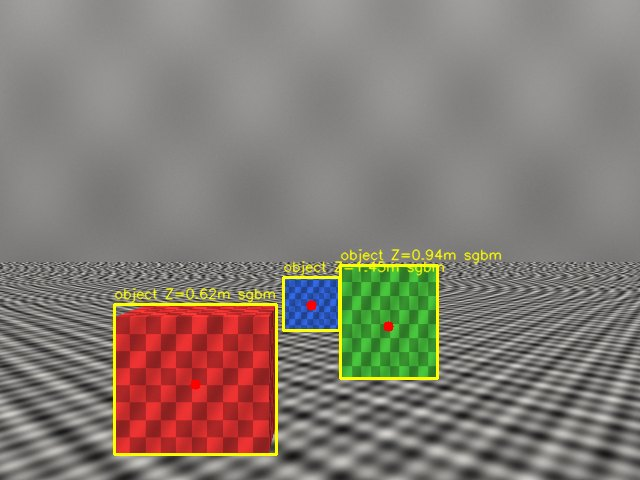
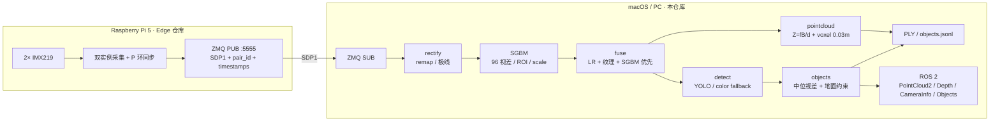
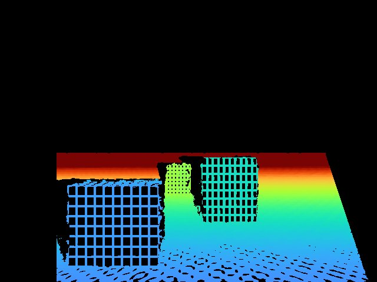
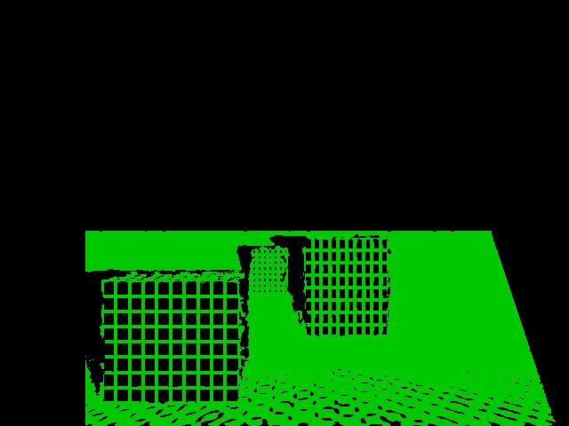

# Stereo Perception — Host

> 双 IMX219 实时双目 3D 感知：校正、SGBM、物体级 3D、体素点云与 ROS 2 输出。




这是**双仓库双目感知系统**的主机端（Host）。Pi 端负责采集、时间戳同步和推流；本仓库负责：

```text
接收双帧 → 去畸变/极线校正 → SGBM → 左右一致性 + 纹理门控
        → SGBM 优先融合 → 检测 → 物体 3D → 深度图/体素点云
        → PLY / objects.jsonl / ROS 2 PointCloud2 / Foxglove
```

- **Edge / Pi 端**：[`pi5-stereo-perception-edge`](https://github.com/zmmmawzfl/pi5-stereo-perception-edge)
- 两端通过 ZMQ + `SDP1` 协议通信；本仓库不包含 `pi/` 采集代码。

---

## 1. 项目定位

面向机器人视觉感知，而不是 3D 建模：

| 用途 | 输出 |
|---|---|
| 导航避障 | 校正深度图、体素彩色点云、ROS 2 `PointCloud2` |
| 抓取初筛 | 2D 框 + 框内点云 + 物体 3D 中心 + `depth_source` |
| 场景理解 | 物体级 JSON、地面约束后的 3D 位置、覆盖率 |
| 硬件/算法评估 | 标定 RMS、极线误差、同步、压缩伪影、帧率报告 |

**非目标**：完整 3D 建模、可编辑 CAD、高保真纹理网格、Blender/SolidWorks 导出、SLAM、6-DoF 抓取位姿、单目深度先验。

SGBM 是**度量锚点**；学习型匹配器只是阶段三的可回退补全，必须同时通过“误差下降 / 覆盖率扩大 / 帧率达标”三项才保留，否则退回纯 SGBM。

## 2. 处理链路



## 3. 功能

- **双目标定**：单目 → `stereoCalibrate` → `stereoRectify`；`B=‖T‖`、`f=P1(0,0)` 从标定读，不写死 83 mm；
- **SGBM 主线**：`numDisparities=96`，支持 ROI 裁剪与 `scale` 降分辨率；
- **融合路由**：左右一致性 `|dL-dR|<=1` + 局部纹理门限；SGBM 有效像素优先，学习型只补失效区，**不做加权平均**；
- **物体级 3D**：框内有效视差中位数 → 深度；地面 RANSAC 约束修正质心高度，同时保留无约束结果；
- **点云**：`Z=fB/d` 反投影，体素 0.03 m 降采样，PLY 二进制导出；
- **ROS 2**：`/stereo/points`、`/stereo/depth`、`/stereo/left/image_rect`、`/stereo/left/camera_info`、`/stereo/objects`；
- **验证报告**：标定/极线、已知距离误差、覆盖率、压缩伪影、分段耗时；
- **无相机路径**：合成场景 + 录制回放，完整跑通链路。

## 4. 当前状态

| 层 | 状态 | 说明 |
|---|---|---|
| 合成/回放完整管线 | ✅ | 80 个 unittest 通过；`tools.run_demo` 可复现 |
| macOS 原生基础链路 | ✅ | Apple M2 / 8 GB；短序列合成 demo 20.27 fps |
| Linux/NVIDIA 目标机 | ❌ 未测 | 不能在 Pi 5 上代替目标 PC 帧率 |
| 真实双目标定 | ❌ 待做 | Pi 相机尚未刚性固定 |
| YOLO 检测 | ⚠️ 权重未随仓库分发 | 缺权重时自动退回彩色连通域占位 |
| 学习型匹配器 | ⚠️ 仅适配器/ONNX 预下载 | 未在 GPU 上实测；FFS 预处理语义待对齐 |
| ROS 2 节点 | ⚠️ 代码完成 | 本机未装 ROS 2，未跑运行期 |
| Foxglove / RTAB-Map / Nav2 | ⚠️ 参数/文档完成 | 未在 ROS 2 环境验证 |
| Docker ROS 2 | ❌ 未构建 | 只做纯 CPU 接口联调，无 GPU |

> 80 个测试里有平台/provider、ROS 打包、SGBM ROI、点云体素等单测；**测试通过不等于实机精度通过**。

## 5. 已验证数字

以下都是**合成场景或开发机**结果，不是目标 PC/真实镜头的验收：

| 指标 | 结果 | 条件 |
|---|---|---|
| 双目 RMS | **0.0471 px** | 15 视图合成标定 |
| 校正后极线 \|dy\| | **0.0102 px** | 中位数 |
| 基线 / 焦距 | **83.025 mm / 531.125 px** | 从标定 `T`、`P1` 读取 |
| 物体 \|ΔZ\| | **1.2 mm**（中位，0.10%） | 合成 8 帧 |
| 真值几何区覆盖率 | **65.4%** | 合成场景 |
| 点云体素化 | **20,620 → 3,518 点** | 0.03 m 体素 |
| H.264 2.5 Mbps 最大深度偏移 | **0.41%** | 压缩往返量化 |
| 处理耗时（Pi 5） | SGBM **150 ms** / 总 **266 ms** / **3.75 fps** | 仅正确性参考 |
| Mac 短序列 demo | **20.27 fps** | M2，3 帧，非目标 PC |
| 实机同步（Pi） | **52.8 ms → 0.56 ms** | 200 帧 P 环；相机未固定 |

| 深度图 | 视差 / 源图 |
|---|---|
|  |  |

## 6. 快速开始

### 6.1 macOS（原生，CoreML 可选）

```bash
git clone https://github.com/zmmmawzfl/pi5-stereo-perception-host.git
cd pi5-stereo-perception-host

python3 -m venv .venv-macos
source .venv-macos/bin/activate
pip install -r requirements-macos.txt

# ultralytics 可能把 opencv-contrib 覆盖成 opencv-python；
# SGBM 右目/ximgproc 需要 contrib，装完依赖后再覆盖一次
pip install --force-reinstall --no-deps opencv-contrib-python

python -m pc.runtime        # 期望看到 CoreMLExecutionProvider
python -m unittest discover -s tests -t .
python -m tools.run_demo --out runs/demo --frames 8 --compression
```

### 6.2 Linux / NVIDIA

```bash
python3 -m venv .venv
source .venv/bin/activate
pip install -r requirements-pc.txt
python -m unittest discover -s tests -t .
python -m tools.run_demo --out runs/demo --frames 8
```

> 在无 GPU 的 Pi 上跑 PC 测试时，如 OpenCV 初始化卡住，加
> `OPENCV_OPENCL_RUNTIME=disabled`。目标 PC 的 TensorRT/帧率必须在 NVIDIA 机器上测。

### 6.3 无相机回放

```bash
python -m pc.receive.live \
  --config configs/pc_macos.yaml \
  --replay-root data/recordings/synth6 \
  --calib runs/demo/calib/stereo_calib.npz \
  --out runs/replay
```

> `data/recordings/` 默认被 gitignore，仓库不带录制数据。
> 如果没有 `data/recordings/synth6`，先在 Pi 仓库生成一段：
> `python -m pi.tools.record_pairs --backend synthetic --frames 6 --out data/recordings/synth6`
> （在本机把 `data/recordings` 放到本仓库对应路径），或直接跳过回放，先跑 6.1 的合成 demo。

输出：`objects.jsonl`、`overlay_*.png`、`source_*.png`、`cloud_*.ply`、`summary.json`。

### 6.4 接 Pi 实时流

先启动 PC 接收器，再启动 Pi（ZMQ PUB 不保留历史）：

```bash
# PC
python -m pc.receive.record_pairs \
  --endpoint tcp://<PI_IP>:5555 \
  --out data/recordings/live --max-pairs 100

# 或直接跑在线感知
python -m pc.receive.live \
  --endpoint tcp://<PI_IP>:5555 \
  --calib data/calib/stereo_calib.npz \
  --config configs/pc.yaml \
  --out runs/live
```

### 6.5 ROS 2（可选）

本机没有 ROS 2 运行期；以下命令需要在 Humble 环境验证：

```bash
python -m pc.ros2.pointcloud_node \
  --calib runs/demo/calib/stereo_calib.npz \
  --replay-root data/recordings/synth6 \
  --max-pairs 10
```

Docker 方式（纯 CPU，无 GPU）：

```bash
docker compose build
docker compose up -d
docker compose exec ros2 bash -lc '
  source /opt/ros/humble/setup.bash &&
  python3 -m pc.ros2.pointcloud_node \
    --calib runs/demo/calib/stereo_calib.npz \
    --replay-root data/recordings/synth6 --max-pairs 10'
```

## 7. 输出与数据契约

| 输出 | 内容 |
|---|---|
| `objects.jsonl` | 每帧物体的 2D 框、3D 中心、深度、`depth_source`、覆盖率 |
| `cloud_*.ply` | 彩色点云，X 右 / Y 下 / Z 前，米 |
| `summary.json` | 标定、帧率、资源、点云统计 |
| ROS 2 `/stereo/points` | `sensor_msgs/PointCloud2`，xyz float32 + rgb uint8 |
| ROS 2 `/stereo/depth` | `16UC1`，毫米 |
| ROS 2 `/stereo/left/camera_info` | 校正后内参：`D=0`、`K=P1[:3,:3]`、`P=P1` |
| ROS 2 `/stereo/objects` | 物体级 JSON 字符串 |

关键约定：

- 左目为参考相机，右目 +B；
- `d = uL - uR > 0`，`Z = f·B/d`；
- 标定文件包含 `K1,D1,K2,D2,R,T,E,F,Q,R1,R2,P1,P2,image_size,rms`；
- 详细字段见 [docs/interfaces.md](docs/interfaces.md)。

## 8. 目录

```text
macos-pc/
├── pc/
│   ├── calib/          # 单目→双目、stereoRectify、极线检查
│   ├── rectify/        # remap 去畸变 + 极线校正
│   ├── stereo/         # SGBM（ROI/scale）、右目视差、ONNX 适配器
│   ├── fuse/           # LR + 纹理门控 + SGBM 优先路由
│   ├── detect/         # YOLO / 彩色连通域
│   ├── objects/        # 框内中位视差、地面约束、3D 中心
│   ├── depth/          # Z=fB/d、体素点云、PLY
│   ├── ros2/           # PointCloud2/Depth/CameraInfo/Objects 节点
│   ├── validate/       # 误差、覆盖率、压缩、运行资源、报告
│   └── pipeline.py     # 端到端编排
├── shared/             # SDP1、配置、统计、合成场景、同步仿真
├── tools/              # run_demo / compression_report / motion_jitter
├── configs/            # default / pc / pc_macos
├── ros2/               # RTAB-Map / Nav2 参数与 launch
├── docs/               # 接口、验收、阶段三、macOS/Docker、交接
└── tests/              # 80 个 PC 侧 unittest
```

## 9. 关键设计

1. **SGBM 优先，不做平均**：融合后的每个像素都有 `source`（SGBM / learned / invalid）；学习型只在 SGBM 失效或低置信时补位。
2. **度量从标定来**：`B=‖T‖`、`f=P1[0,0]`、`cx/cy` 都从标定文件读，不假设 83 mm。
3. **96 视差 + ROI/scale**：算力受限时先降分辨率/裁 ROI；`scale<1` 时禁止非零 `minDisparity`，避免内部缩放错位。
4. **地面约束默认开启**：平面支撑物体用 RANSAC 修正 `Y`，但报告同时保留无约束数字，方便对照。
5. **体素 0.03 m**：点云进 ROS/Foxglove 前先降采样，避免带宽和渲染压力。
6. **TSDF 可选**：需要 Open3D + 外部位姿，不作为主线依赖。

## 10. 已知限制

- 真实镜头畸变、装配刚性、温度漂移未验证；当前只有合成/录制数据；
- Pi 相机尚未刚性固定，真实标定/尺度/运动同步未验收；
- 学习型匹配器未在 GPU 上实测，不能拿预下载 ONNX 当性能证据；
- YOLO 权重不随仓库分发，默认彩色连通域只验证链路，不代表检测精度；
- ROS 2/Foxglove/RTAB-Map/Nav2 只有代码与参数，未在 ROS 2 环境跑过；
- Docker 未构建；容器是纯 CPU 接口联调，不能代表 Mac 原生或 RTX 性能；
- Mac CoreML 数字不能等同 RTX 3060 TensorRT。

## 11. 文档

| 内容 | 位置 |
|---|---|
| 项目状态/决策/踩坑 | [docs/PROJECT_STATE.md](docs/PROJECT_STATE.md) |
| 接口/坐标/消息 | [docs/interfaces.md](docs/interfaces.md) |
| Mac 首次搬运与执行 | [docs/PC_MACOS_START.md](docs/PC_MACOS_START.md) |
| macOS / Docker 设计 | [docs/macos_docker.md](docs/macos_docker.md) |
| ROS 2 / Foxglove / RTAB-Map / Nav2 | [docs/ros2_foxglove.md](docs/ros2_foxglove.md) |
| 阶段三学习型对照 | [docs/stage3.md](docs/stage3.md) |
| 验收映射 | [docs/acceptance.md](docs/acceptance.md) |
| Pi↔PC 联调 | [docs/runbook.md](docs/runbook.md) |
| Pi 边缘端 | [pi5-stereo-perception-edge](https://github.com/zmmmawzfl/pi5-stereo-perception-edge) |

## 12. 模型与许可

模型权重**不随仓库分发**（`models/` 已 gitignore）：

- YOLOv8n：Ultralytics，AGPL-3.0；
- Fast-FoundationStereo ONNX：NVIDIA Open Model Agreement（研究/评估用途）。

使用前请自行下载并确认许可；仓库代码的 License 尚未指定。
